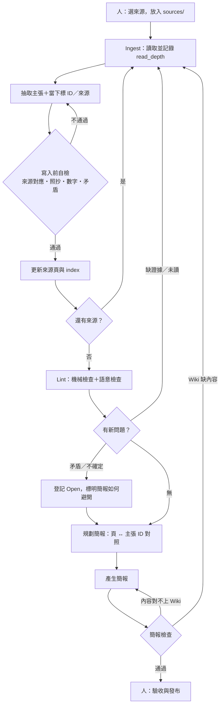

# AGENTS.md：Bayesian Optimization LLM Wiki 維護規範

本檔是 AI（維護者）每次工作前必讀的規範。人負責選來源與最終驗收；AI 負責 ingest、整理、檢查與產生簡報。

## 1. 資料夾與權限

```
bayesopt-project/
├── AGENTS.md        # 本檔（人與 AI 共同維護）
├── sources/         # 原始 PDF（5 篇）。唯讀：AI 不得修改或刪除
├── wiki/            # AI 維護：s1–s5 來源頁 + index.md
└── slides/          # AI 產生：bayesopt-deck.html
```

- 知識只能單向流動：`sources/` → `wiki/` → `slides/`。簡報不得直接使用 `sources/` 或模型記憶中的內容。
- 若簡報需要 Wiki 沒有的事實，必須先回到 Ingest 補進 Wiki，再產生簡報。

## 2. 內容規則（Schema）

1. **一手來源**：Wiki 只收論文、官方文件等一手來源；部落格或轉述只能當線索，不得當依據。
2. **主張編號**：每則主張有 ID（C1.1 等）並標來源 ID（S1–S5）。沒有來源的句子不准寫進 Wiki。
3. **改寫**：一律用自己的話。單一來源的直接引文少於 15 個字，且每個來源最多一則。不轉錄公式、圖表與長段落。
4. **讀取深度**：每個來源頁 frontmatter 必填 `read_depth`。只讀到摘要或片段的來源，主張必須標「僅摘要層級」，不得引用細節（數字、實驗設定、演算法步驟）。
5. **矛盾與不確定**：來源內部矛盾、來源之間不一致、只有二手證據的主張，一律放 `index.md` 的 Open（O 編號），並寫明簡報如何避開。Open 中的內容不得進簡報。
6. **數字與適用範圍**：任何數字、範圍、百分比（例如維度上限、次數、時間），必須回到原文逐字核對；有算術的要重算並記錄。
7. **符號慣例**：BO 統一用「最大化」；來源若用最小化，註明等價於對 f 取負。

## 3. 來源頁格式

```
---
id: S#
title / authors / venue / url / type
read_depth: 全文｜部分（列出讀到的章節）｜僅摘要
---
# 一句話摘要
## 主張（表格：ID｜主張）
## 警示（矛盾、未讀範圍、排除項）
## 連結（概念頁、相關來源）
```

## 4. 操作（Operations）

### 4.1 Ingest（一次一篇）
1. 讀取來源，並記錄 `read_depth`（實際讀到哪裡，不是想讀到哪裡）。
2. 逐段抽取主張，立刻標 ID 與來源（**檢查前移：在寫入時就標，不是寫完再補**）。
3. 自我檢查（寫入前）：
   - [ ] 每則主張能對到原文某處？
   - [ ] 有 15 字以上的連續照抄嗎？有就改寫。
   - [ ] 所有數字都已回原文核對？
   - [ ] 來源內部有前後不一致嗎？有就列 Open。
4. 更新：該來源頁、`index.md` 的概念地圖、Ingest 紀錄。
5. **失敗處理**：若 `read_depth` 為「僅摘要」，狀態標 ⚠️，並在 Open 登記「需補讀」；不得略過。

### 4.2 Query（查詢 Wiki）
1. 先讀 `index.md`，只打開相關的來源頁。
2. 回答只用 Wiki 內的主張，並附主張 ID。
3. Wiki 查不到時，回覆「Wiki 尚無此內容」，並提議 Ingest；不得用模型記憶補答。

### 4.3 Lint（健康檢查）
分兩層：
- **機械檢查（可程式化）：** 孤兒頁、`index.md` 是否連到所有來源頁、每個主張是否有來源 ID、frontmatter 欄位是否齊全、15 字連續照抄。
- **語意檢查（LLM）：** 跨來源一致性（例如同一數值各來源是否相同）、來源內部矛盾、讀取深度是否足以支撐該主張、算術。

每次 Lint 後把結果寫進 `index.md` 的 Lint 紀錄；新問題進 Open。

### 4.4 Generate Slides（產生簡報）
1. 規劃：先從 `index.md` 列出每頁要用的主張 ID（先有對照表，再寫內容）。
2. 只使用狀態為 ✅ 且不在 Open 內的主張。
3. 每頁底部標示主張 ID 與來源 ID。
4. 寫完後做簡報檢查（見 §5），不通過則回到對應節點。

## 5. 流程圖（Loop / Graph）



**會重複的步驟：** B→C→D（每個來源各跑一圈，自檢不過就回 C）；G→H→B（Lint 找出缺證據時回補）；K→L（簡報檢查不過時重新生成）。

## 6. 重試上限與升級

- 同一節點最多自動重試 **2 次**；仍不通過就停下，在 Open 登記並交給人決定。
- 「Wiki 缺內容」不允許在簡報節點直接補，必須回到 B。
- 人類驗收時優先看三處：Open 清單、讀取深度為薄弱的來源、簡報與 Wiki 的對照表。

## 7. 簡報檢查清單（節點 L）

- [ ] 每頁都有主張 ID，且都存在於 `wiki/`。
- [ ] 沒有使用 Open 內的內容。
- [ ] 數字與 Wiki 完全一致（含單位）。
- [ ] 沒有「僅摘要層級」的來源被引用細節。
- [ ] 教學結構：問題 → 概念 → 流程 → 應用 → 限制 → 回顧。
- [ ] 可正常瀏覽（翻頁、深色模式、手機寬度）。

## 8. 修訂紀錄（根據實際執行調整）

| 版本 | 觀察到的問題 | 調整 |
|---|---|---|
| v1 | 第一輪是先寫 Wiki、再做簡報，規則只寫在 Wiki 檔頭；S3、S5 因為只讀到摘要或片段，仍被寫成與全文來源同等的主張頁。 | 新增 `read_depth` 必填欄位與 §2.4；薄弱來源標 ⚠️ 並進 Open（O5）。 |
| v1 | Lint 才發現 S1 前後說法不一致（Matern 核可微階數）。若等到簡報才發現，已經寫進內容。 | 把「來源內部矛盾」檢查前移到 Ingest 寫入前（§4.1 自檢），並新增 §2.5。 |
| v1 | 簡報頁與 Wiki 主張的對應是事後補標。 | 改成 §4.4：先做「頁 ↔ 主張 ID」對照表，再寫簡報。 |
| v1 | 最大化／最小化寫法在 S2 與 S3 不同，容易在簡報中混用。 | 新增 §2.7 符號慣例。 |

**最常出錯的節點：** 取得資料／Ingest（讀得夠不夠深、是否把證據不足的內容寫成主張）。因此檢查集中放在 Ingest 寫入前，而不是留到最後的簡報檢查。
